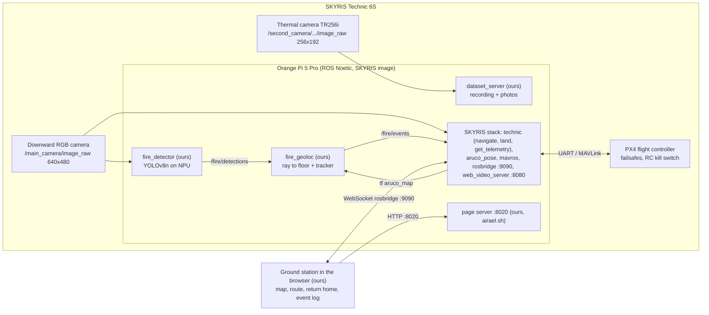

# Team Brics: autonomous fire hotspot detection (HiTech 2026, Flying Robotics, Case 1)

A drone that flies a route over an indoor ArUco marker field by itself, detects a campfire (and trees)
with a YOLOv8n network on its own NPU, works out each object's position on the map, and shows it live
in a web ground station with type, time and confidence. The operator can send it home at any time.
Customer: ANO "University 2035", Case 1 "Autonomous forest fire monitoring".

**Team:** Omar Alblooshi (flight control and hardware) · Mohammed Alhammadi (software and AI).
"Airael" was the team's working name; it remains in topic names (`/airael/...`), folder names
(`~/airael`) and the systemd unit (`airael.service`) because those were tested on the drone under that name.

## What runs where

| Part | Runs on | Files |
|------|---------|-------|
| Fire detector: YOLOv8n `.rknn` on the RK3588 NPU, publishes `/fire/detections` | drone | [`drone/fire_detector_node.py`](drone/fire_detector_node.py), [`drone/fire_detector.launch`](drone/fire_detector.launch) |
| Geolocation: box → position on the ArUco map, tracking, publishes `/fire/events` | drone | [`drone/fire_geoloc.py`](drone/fire_geoloc.py) |
| Dataset recording and photo capture for the ground station | drone | [`drone/dataset_server.py`](drone/dataset_server.py), [`drone/dataset_capture.py`](drone/dataset_capture.py) |
| Start/stop/status of all our services, boot unit | drone | [`drone/airael.sh`](drone/airael.sh) |
| Installer | drone | [`drone/install_drone.sh`](drone/install_drone.sh) |
| Module B numbers from a flight recording | drone or laptop with ROS | [`drone/flight_report.py`](drone/flight_report.py) |
| Ground station: map, route flight, return home, event log, camera, dataset and photo tabs | browser (served by the drone, port 8020) | [`ground_station/index.html`](ground_station/index.html) |
| Dataset preparation, training, export to `.rknn` | laptop | [`training/yolo_prep.py`](training/yolo_prep.py), [`training/train_gpu.sh`](training/train_gpu.sh) |
| Module C calculation workbook | laptop | [`docs/Module_C_Economic_Model.xlsx`](docs/Module_C_Economic_Model.xlsx), [`tools/build_module_c_workbook.py`](tools/build_module_c_workbook.py) |

## Architecture



Flight control never depends on our detection code: the route and Return home are `navigate`/`land`
service calls to the SKYRIS `technic` package, which drives PX4. Details, topics, message formats and the
differences from the Module A design: [docs/architecture.md](docs/architecture.md).

## Dependencies

- **Drone:** SKYRIS Technic 6S with the SKYRIS Orange Pi image (Ubuntu, ROS Noetic, Python 3.8,
  `technic`, `aruco_pose`, `yolo_face`, `rosbridge`, `web_video_server`, rknn-toolkit-lite2 2.3.0 and
  librknnrt 2.3.0 are already on it). Our code uses only packages on that image: `rospy`, `numpy`, `cv2`,
  `cv_bridge`, `tf2_ros`, `message_filters`, `rknnlite`. No internet is needed on the drone.
- **Laptop (training and export):** Linux, Python 3.11, [`requirements-laptop.txt`](requirements-laptop.txt)
  (Ultralytics, `rknn-toolkit2==2.3.2`, `onnx==1.16.1`).
- **Ground station:** any current browser on the same network as the drone. Nothing to install.
- **Tests (any computer, no ROS):** Python 3.8+, [`requirements-dev.txt`](requirements-dev.txt).

## Install and run

Full step-by-step instructions for someone who did not write the code: [docs/deployment_guide.md](docs/deployment_guide.md).
Short version:

```bash
# laptop: copy the repository and the trained model to the drone (Ethernet 192.168.50.2 or Wi-Fi 10.42.0.1)
scp -r brics-firewatch orangepi@192.168.50.2:~/
ssh orangepi@192.168.50.2 "mkdir -p ~/airael/models"
scp best-rk3588.rknn orangepi@192.168.50.2:~/airael/models/fire-rgb-rk3588.rknn

# drone
cd ~/brics-firewatch && bash drone/install_drone.sh
~/airael/airael.sh start --detector        # page server, thermal JPEG, dataset server, detector, geolocation
~/airael/airael.sh status

# laptop browser
http://192.168.50.2:8020/                  # or http://10.42.0.1:8020/ over the drone's Wi-Fi
```

Operating the drone (start-up, flying the route, Return home, safe shutdown, typical errors):
[docs/operating_manual.md](docs/operating_manual.md).

## Results

Thresholds approved for Module B are in the [test plan](docs/module_B/test_plan.md). Only values with
a record are filled in; the rest are **TODO** with the command that produces them.
Full table with procedures: [docs/module_B/test_results.md](docs/module_B/test_results.md).

| ID | Characteristic | Threshold | Measured | Status | Evidence |
|----|----------------|-----------|----------|--------|----------|
| MC1 | Route waypoints reached, no pilot input | 100 % within 0.30 m | TODO: ground station → Download route log | not tested | — |
| MC2 | Campfire mAP@0.5 | ≥ 85 % | TODO: `yolo detect val model=$HOME/yolo/runs/fire_rgb/weights/best.pt data=$HOME/yolo/ds_rgb/data.yaml imgsz=320` | not recorded | [dataset and model](evidence/2026-11-12_dataset_and_model.txt) |
| MC3 | Additional object detected per pass | ≥ 1 | TODO: `python3 ~/airael/flight_report.py <bag> --fire tree` | not tested | — |
| MC4 | 1-s windows with ≥ 10 FPS on the NPU | > 90 % of flight | bench only: 30.1 FPS, 19–26 ms per frame (12 Nov 2026); flight share TODO: `flight_report.py <bag>` line T2 | bench OK, flight not tested | [detector bench](evidence/2026-11-12_detector_rgb_bench.txt) |
| MC5 | Object coordinate error | ≤ 0.5 m | TODO: `flight_report.py <bag> --truth campfire=x,y tree=x,y` line T3 | not tested | — |
| MC6 | Objects on the live map, latency | 100 %, ≤ 2 s | TODO: event log CSV `latency_s` + screen recording | not tested | — |
| MC7 | Return on command | starts ≤ 2 s, lands ≤ 0.5 m from home, no pilot input | TODO: command log lines "Return home: moving…" and "…landed X m from home" | not tested | — |

Other measured values: thermal camera 25.01 Hz over 1428 frames (11 Nov 2026, record on the laptop);
`/main_camera/image_web/compressed` at 30 Hz after defect D4 was fixed; rangefinder 0.037 m with the drone
resting on the table (Module A); model YOLOv8n 320 px, 3,132,950 parameters, output `(1, 6, 2100)`.
Defects found and fixed: [docs/module_B/defect_log.md](docs/module_B/defect_log.md).

## Tests

```bash
python3 -m unittest discover -s tests -v
```

The tests run without ROS or the NPU (small stand-ins in [`tests/rosstubs.py`](tests/rosstubs.py)). They cover the
detector's output decoding, NMS and letterbox, one frame through the detector node, the geolocation
geometry, tracker and node output, the flight-report maths, the dataset tool, script syntax, the installer,
the ground-station JavaScript syntax (when Node.js is present), the same class list and camera in every file,
and every link and repository path in the docs.

## Repository layout

```
drone/            code that runs on the drone, installer, flight report
ground_station/   the web ground station (one HTML file, served by the drone on :8020)
training/         dataset preparation, GPU training and export to .rknn
tools/            Module C workbook builder
tests/            automated tests (no ROS needed)
docs/             architecture, operating manual, deployment guide, Modules A-D, test plan, results, defects
evidence/         raw records behind the results
```

## Documentation

- [Architecture, interfaces and data formats](docs/architecture.md)
- [Operating manual](docs/operating_manual.md) · [Deployment guide](docs/deployment_guide.md)
- Module A: [engineering design](docs/module_A_engineering_design.md)
- Module B: [test plan](docs/module_B/test_plan.md) · [results](docs/module_B/test_results.md) · [defect log](docs/module_B/defect_log.md)
- Module C: [economic feasibility](docs/module_C_economic_feasibility.md)
- Module D: [project defense](docs/module_D_project_defense.md)

## Licence

MIT for the team's own code and documents, see [LICENSE](LICENSE). Third-party components keep their own
licences; see [docs/architecture.md](docs/architecture.md#third-party-components).
